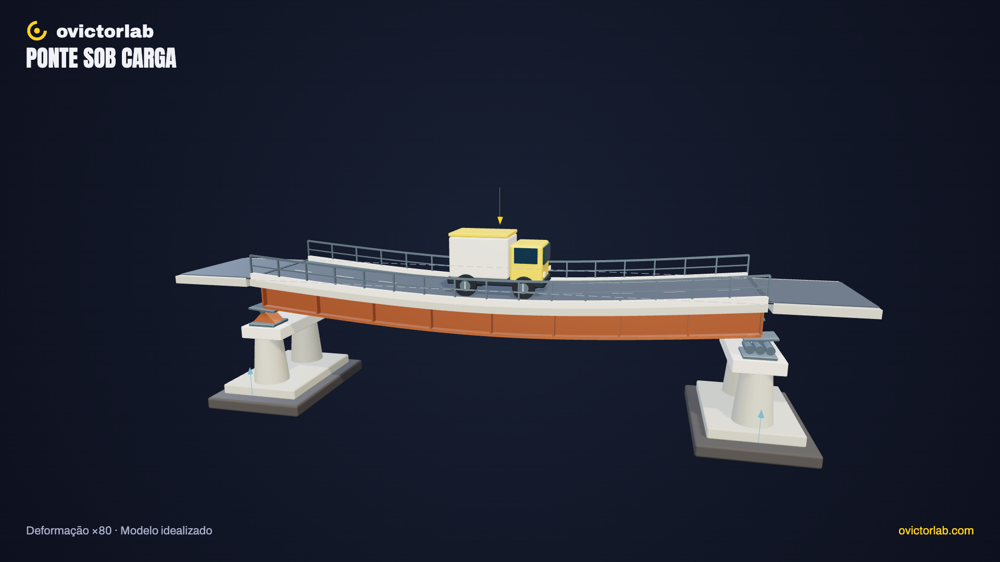

# Ponte sob carga

**[Abrir a experiência →](https://victorsodre.github.io/ponte-sob-carga/)** · [Os 10 experimentos](docs/COLECAO.md) · [Publicação e manutenção](docs/PUBLICACAO.md)

[](https://victorsodre.github.io/ponte-sob-carga/)

**O que muda numa ponte quando um veículo passa?**

Um único tipo estrutural, com apoios, tabuleiro e carga móvel. Deformações ampliadas são identificadas como ilustração e acompanhadas da forma original.

Direção e autoria editorial: **Victor Sodré / ovictorlab**. [Site](https://ovictorlab.com/) · [Referência Fusquinha](https://victorsodre.github.io/fusquinha/) · [Repositório](https://github.com/victorsodre/ponte-sob-carga).

## Entenda no vídeo

<a href="https://www.youtube.com/watch?v=-Aht48DzVu8"></a>

**[Por que as pontes não caem? (elas se mexem o tempo todo)](https://www.youtube.com/watch?v=-Aht48DzVu8)**

Veja como as pontes acomodam cargas e movimentos. Depois, mova o veículo e compare a forma original com a deformação ampliada.

O player incorporado fica [na página do experimento](https://victorsodre.github.io/ponte-sob-carga/#video), com carregamento por clique e sem reprodução automática.

## Por que desenvolver

O canal já tem um vídeo longo sobre pontes, com 239 visualizações na consulta. A prioridade se apoia na adequação à interação e na conexão editorial, não em um grande alcance medido. Consulta em 07/11/2026. Métricas acumuladas são sinais de interesse; não comprovam demanda pelo aplicativo ou alcance orgânico.

- [Pontes — YouTube](https://www.youtube.com/watch?v=-Aht48DzVu8)
- [Pontes — Short](https://www.youtube.com/watch?v=zQk4GWeQF0g)

## Começar por aqui

1. [Escopo e critérios de conclusão](docs/ESCOPO.md).
2. [Lista de execução](docs/EXECUCAO.md).
3. [Identidade visual do ovictorlab](docs/IDENTIDADE-VISUAL.md).
4. [Arquitetura implementada e reaproveitamento do Fusquinha](docs/ARQUITETURA.md).
5. [Assets e fontes verificadas](docs/ASSETS-E-FONTES.md).
6. [Manutenção, validação e publicação](docs/MANUTENCAO.md).
7. [Decisões e estado do projeto](docs/DECISOES.md).
8. [Textos para o X](POSTAGENS-X.md) e [ordem da coleção](docs/COLECAO.md).

## Executar e conferir

Node ≥22.18. Dependências fixadas no lockfile.

```sh
npm ci
npm run dev
npm test
npm run check
npm run build
npm run preview
```

Build estático em `dist/`, com caminhos relativos e suporte a subpasta. Sem backend, LLM ou GPU de produção. [Apuração e equações](docs/APURACAO.md) · [Validação](docs/VALIDACAO.md) · [Direção visual](docs/DIRECAO-VISUAL.md).

## O que funciona

- Carga móvel por slider, três posições e travessia com pausa e parada no fim. Intensidade relativa 0–100%.
- Forma original, deformada e comparação com referência tracejada. Ampliação ×1, ×40 ou ×80, sempre identificada.
- Reações relativas dos dois apoios, atualizadas por equilíbrio estático. Sem cálculo de tonelagem ou capacidade segura.
- Seis conjuntos, seleção por lista/clique, isolamento, câmera, busca, tour, malha, reset e PNG horizontal/vertical.
- Teclado, movimento reduzido, pausa em aba oculta, renderização sob demanda e explicações acessíveis sem WebGL. Sem áudio ou autoplay.

**Limites:** uma viga equivalente idealizada de rigidez constante e uma carga pontual; caminhão cenográfico. Não simula distribuição entre eixos, peso próprio, impacto, vibração, ruptura ou distribuição transversal. Geometria e intensidade sem escala real. Não é ferramenta de dimensionamento ou diagnóstico. Celular emulado no Chrome, sem ensaio em telefone físico/Safari.

**Próxima etapa fora da implementação:** escolher hospedagem e autorizar publicação, se desejado. Posts permanecem rascunhos para Victor publicar posteriormente.
